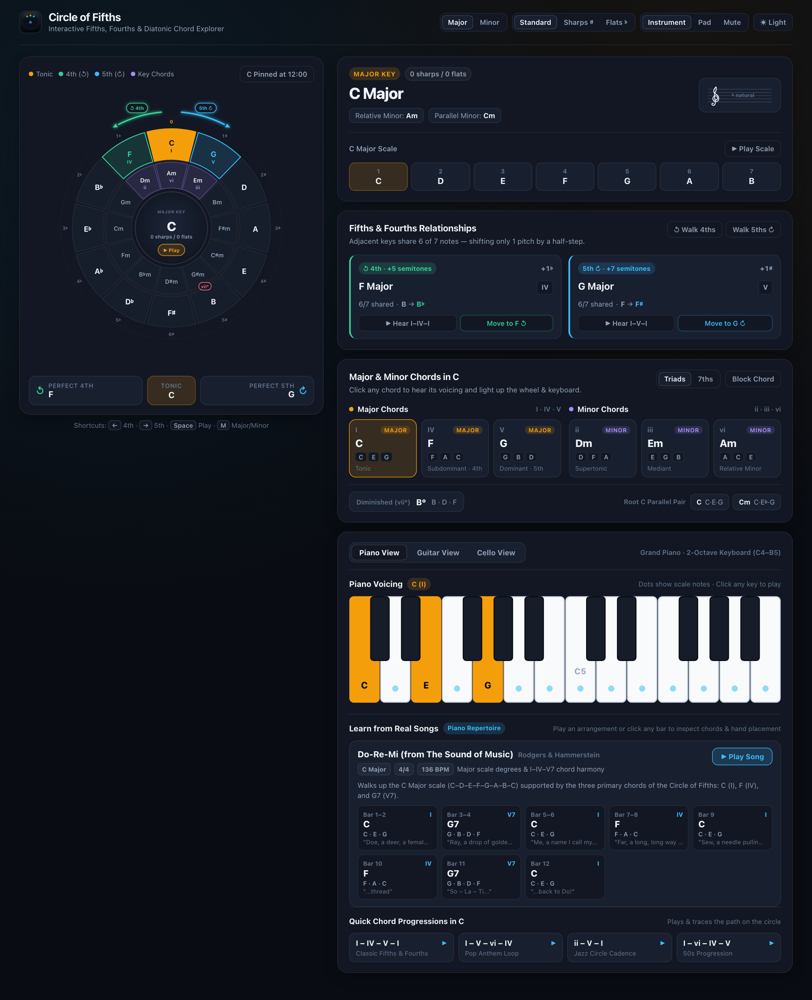
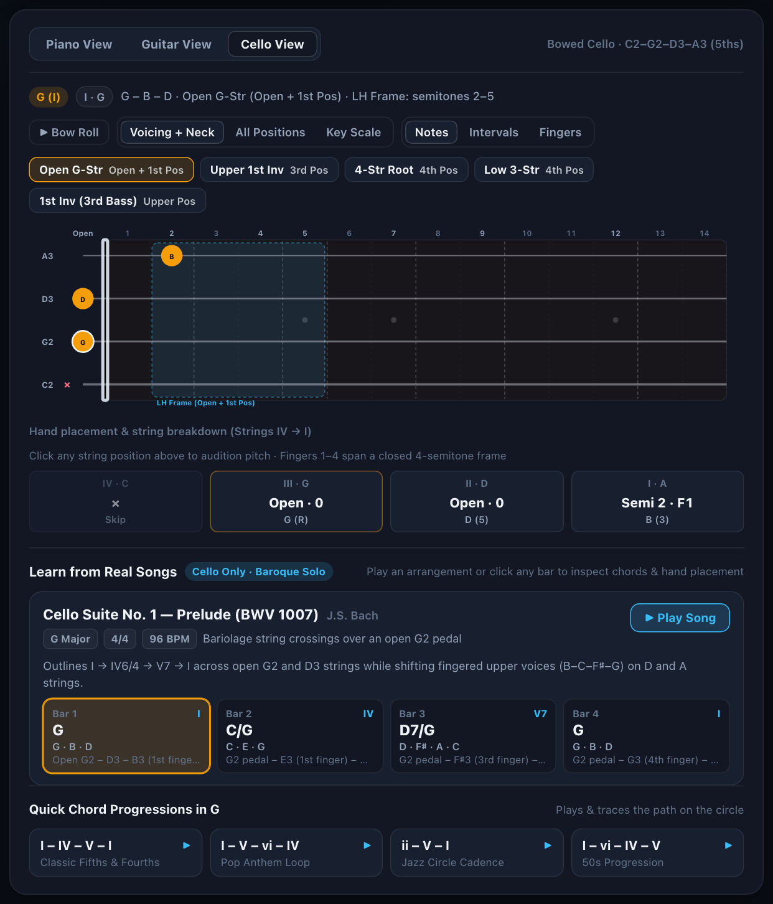

<div align="center">
  
  <h1>Circle of Fifths Explorer</h1>
  <p>
    <strong>An interactive music theory studio &amp; multi-instrument companion</strong><br />
    Explore keys, fifths/fourths harmony, diatonic chords, and hand placement across <strong>Piano</strong>, <strong>Guitar</strong>, and <strong>Cello</strong> — powered by zero-dependency Web Audio synthesis.
  </p>

  <p>
    <a href="https://musical-scales.juyoung-m-yoo.workers.dev/">
      
    </a>
  </p>

  <p>
    
    
    
    
    
    
  </p>

  <p>
    <a href="https://musical-scales.juyoung-m-yoo.workers.dev/">Live App</a> ·
    <a href="#quick-tour">Quick Tour</a> ·
    <a href="#instrument-views">Instruments</a> ·
    <a href="#features">Features</a> ·
    <a href="#keyboard-shortcuts">Shortcuts</a> ·
    <a href="#run-locally">Run Locally</a> ·
    <a href="./docs/architecture.md">Architecture</a>
  </p>
</div>

<br />

<p align="center">
  <picture>
    <source media="(prefers-color-scheme: dark)" srcset="./docs/images/studio-piano-dark.png" />
    <source media="(prefers-color-scheme: light)" srcset="./docs/images/studio-piano-light.png" />
    
  </picture>
  <br />
  <sub>Dark &amp; Light themes — interactive Circle of Fifths wheel, treble key signature staff, 4th/5th pitch diffs, diatonic chords, and live instrument views.</sub>
</p>

---

## Quick Tour

1. **Pick any key on the wheel** — Click the outer **Major** or inner **Relative Minor** ring (or press `←` / `→`). Toggle **C Pinned at 12:00** / **Selected at 12:00** to keep `C` fixed or smoothly rotate your tonic to the top.
2. **See why neighbors connect** — Compare counter-clockwise **4th (`+5`)** and clockwise **5th (`+7`)** keys side by side: `6/7` scale notes remain identical while only a single half-step shifts. Audition `I–IV–I` / `I–V–I` cadences or walk continuously around the wheel.
3. **Audition chords & progressions** — Click any diatonic chord card, toggle **Triads / 7ths** and **Block Chord / Arpeggio On**, or launch progressions like `ii – V – I` to hear and trace harmony directly on the wheel.
4. **Switch instruments & learn real songs** — Toggle between **Piano View**, **Guitar View**, and **Cello View** at any time. Audio, voicings, fingerings, and bar-by-bar song examples adapt automatically.

---

## Instrument Views

| Tab             | Layout & Range                                 | Voicings, Overlays & Audio                                                                                                                               | Built-in Song Repertoire                                                                    |
| :-------------- | :--------------------------------------------- | :------------------------------------------------------------------------------------------------------------------------------------------------------- | :------------------------------------------------------------------------------------------ |
| **Piano View**  | 2-octave clickable keyboard (`C4`–`B5`)        | Chord voicing highlights, scale-tone dots, procedural Grand Piano synthesis                                                                              | _Do-Re-Mi_ (_The Sound of Music_) — `C Major · 4/4 · 136 BPM`                               |
| **Guitar View** | 6-string, 15-fret neck (`E A D G B e`)         | Open & movable CAGED/barre shapes, `Voicing + Neck` / `All Positions` / `Key Scale`, `Notes` / `Intervals`, `▶ Strum`, Karplus-Strong nylon string synth | _Amazing Grace_ — `G Major · 3/4 · 118 BPM`                                                 |
| **Cello View**  | 4-string fretless neck (`C2–G2–D3–A3`, fifths) | Closed 4-semitone left-hand frames (`LH Frame`), `Notes` / `Intervals` / `Fingers` (`0–4`), `▶ Bow Roll`, bowed vibrato & body-formant synth             | _Bach — Cello Suite No. 1 Prelude (BWV 1007)_ — `G Major · 4/4 · 96 BPM` _(Cello tab only)_ |

<table>
  <tr>
    <td width="50%" align="center">
      <strong>Guitar View — 15-Fret CAGED Neck &amp; <em>Amazing Grace</em></strong><br /><br />
      
    </td>
    <td width="50%" align="center">
      <strong>Cello View — Fretless 5ths Neck &amp; <em>Bach Suite No. 1</em></strong><br /><br />
      
    </td>
  </tr>
</table>

---

## Features

- **Circle & Key Signatures**
  - Concentric Major and Relative Minor rings with Roman numeral overlays (`I–vii°` / `i–VII`) and clickable `↺ 4th` / `5th ↻` arcs
  - Live treble-clef key signature staff SVG and clickable scale-degree strip (`▶ Play Scale`)
  - Global accidental preference (`Standard`, `Sharps ♯`, `Flats ♭`), per-key enharmonic flips (`B/C♭`, `F♯/G♭`, `D♭/C♯`), and one-click **Relative** / **Parallel** key jumps
- **Fifths & Fourths Harmony**
  - Exact `6/7` shared-note comparison and single-pitch half-step diff for adjacent keys
  - Instant `I–IV–I` / `I–V–I` cadence playback and continuous **Walk 4ths** / **Walk 5ths** stepping
- **Chords & Progressions**
  - Grouped diatonic **Major**, **Minor**, **Diminished**, **Harmonic Minor `V`**, and **Root Parallel Pair** cards
  - 4 curated **Quick Chord Progressions** per mode (`I–IV–V–I`, `I–V–vi–IV`, `ii–V–I`, `I–vi–IV–V` in Major; `i–iv–v–i`, `i–VI–III–VII`, `i–iv–VII–III`, `ii°–V–i` in Minor)
- **Zero-Dependency Web Audio & Themes**
  - Header sound switcher (**Instrument** auto-match, warm **Pad**, or **Mute**) with zero external audio files
  - **Dark** and **Light** UI themes

---

## Keyboard Shortcuts

| Key     | Action                                                 |
| :------ | :----------------------------------------------------- |
| `←`     | Step counter-clockwise to the **Perfect 4th** neighbor |
| `→`     | Step clockwise to the **Perfect 5th** neighbor         |
| `M`     | Toggle between **Major** and **Natural Minor** mode    |
| `Space` | Play the selected key's **tonic chord**                |

---

## Run Locally

### Prerequisites

- [Bun](https://bun.sh/) (`bun@1.4.4` recommended)

### Quick Start

```bash
git clone https://github.com/NewGuy012/musical-scales.git
cd musical-scales
bun install
bun dev       # open http://localhost:5173
```

### Available Scripts

| Command           | Description                                                              |
| :---------------- | :----------------------------------------------------------------------- |
| `bun dev`         | Start the Vite + Cloudflare Workers dev server (`http://localhost:5173`) |
| `bun test`        | Run unit, voicing, DSP, and UI tests plus `bun fmt --check`              |
| `bun fmt`         | Format codebase with Bun's native formatter (`bunfig.toml`)              |
| `bun check -b`    | Typecheck across app, Node, and Worker `tsconfig` projects               |
| `bun lint`        | Run `bun check -b` and `bun fmt --check`                                 |
| `bun run build`   | Typecheck and build client + worker bundles into `dist/`                 |
| `bun run preview` | Build and preview the production bundle locally                          |
| `bun deploy`      | Deploy to Cloudflare Workers via Wrangler                                |

<details>
<summary><strong>Project Structure &amp; Architecture</strong> — explore source directories and technical docs</summary>

<br />

```text
musical-scales/
├── docs/
│   ├── architecture.md          # Data flow, DSP, and theory engine overview
│   └── images/                  # README showcase screenshots
├── public/                      # Static brand assets and security headers
├── src/
│   ├── react-app/
│   │   ├── App.tsx              # Root state, keyboard shortcuts, and sequencer
│   │   ├── audio/synth.ts       # Web Audio synth (Piano, Guitar, Cello, Pad)
│   │   ├── components/          # Wheel, staff, chord cards, and instrument views
│   │   └── theory/              # Scales, circle neighbors, Guitar/Cello voicings, songs
│   └── worker/index.ts          # Hono edge worker with security headers
└── tests/                       # Theory, voicing, audio DSP, and SSR tests
```

See [`docs/architecture.md`](./docs/architecture.md) for the full Mermaid data-flow diagram, Karplus-Strong guitar DSP details, and module-by-module breakdown.

</details>
