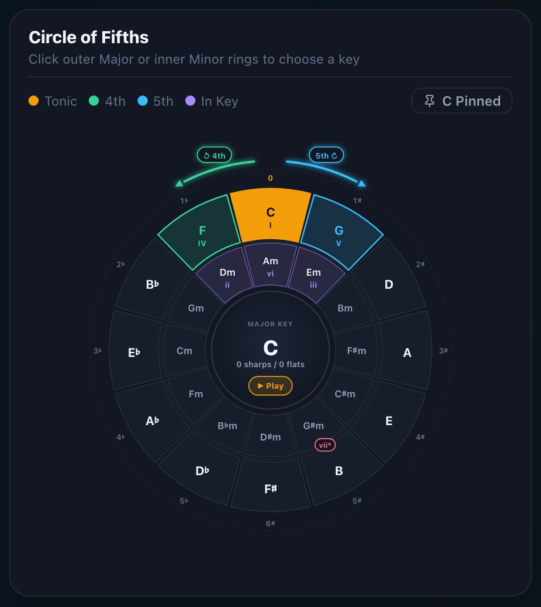

<div align="center">
  
  <h1>Musical Scales</h1>
  <p>
    <strong>An interactive music theory studio &amp; multi-instrument companion</strong><br />
    Explore keys on the Circle of Fifths, build chords and progressions, study MusicXML scores in <strong>Music Teacher</strong>, and hear live voicings across <strong>Piano</strong>, <strong>Guitar</strong>, <strong>Violin</strong>, and <strong>Cello</strong> — powered by built-in Web Audio synthesis.
  </p>

  <p>
    <a href="https://musical-scales.juyoung-m-yoo.workers.dev/">
      
    </a>
  </p>

  <p>
    <a href="https://musical-scales.juyoung-m-yoo.workers.dev/">Live App</a> ·
    <a href="#whats-inside">What's Inside</a> ·
    <a href="#instruments--musicxml-ingestion">Instruments &amp; MusicXML</a> ·
    <a href="#keyboard-shortcuts">Shortcuts</a> ·
    <a href="#run-locally">Run Locally</a>
  </p>
</div>

<br />

<p align="center">
  
  <br />
  <sub>Interactive <strong>Circle of Fifths</strong> wheel with relative minor inner ring, 4th/5th neighbor navigation, and instant tonic playback.</sub>
</p>

---

## What's Inside

1. **Circle of Fifths** — Click the outer **Major** or inner **Relative Minor** ring to switch keys and hear the tonic chord. Toggle **C Pinned** / **Key at 12:00** to keep `C` fixed or rotate the active key to the top.
2. **Instruments** — Switch between **Piano**, **Guitar**, **Violin**, and **Cello** at any time, audition 13 chord variations (`Maj`, `m`, `7`, `maj7`, `m7`, `dim`, `dim7`, `m7♭5`, `aug`, `add9`, `m(add9)`, `sus4`, `sus2`), and play notes directly on the keyboard, fretboard, or fingerboards.
3. **Neighbors** — Compare adjacent **4th** and **5th** keys side by side (`6/7` shared notes, single half-step change) directly beneath the Instruments dock, audition `I–IV–I` / `I–V–I` cadences, or walk smoothly around the circle.
4. **Chords** — Collapsible theory workspace (collapsed by default) below Neighbors, covering:
   - **Chords & Progressions**: Treble **Key Signature** staff, Relative/Parallel jumps, enharmonic flips (`B/C♭`, `F♯/G♭`, `D♭/C♯`), 7-note scale, Diatonic Major/Minor/Diminished chords (Triads or 7ths, block or Arpeggio), and curated progressions.
   - **Passing & Substitutions**: Interactive chromatic passing slides, symmetric `dim7` families, secondary dominants, and tritone substitutions.
5. **Music Teacher → Learn with Real Songs** — Collapsible section (collapsed by default) below the Chords section. Load **MusicXML** (`.musicxml`, `.xml`, `.mxl`) scores via CLI ingestion or instant browser drag-and-drop preview with bar-by-bar harmony, study guides, practice speeds (`0.5x–1.25x`), expressive articulations, and scrubbable transport synced live to the active instrument and Circle of Fifths.

---

## Instruments & MusicXML Ingestion

| Instrument | Interactive View                                                                                                             | MusicXML Support (`Learn with Real Songs`)                                                          |
| :--------- | :--------------------------------------------------------------------------------------------------------------------------- | :-------------------------------------------------------------------------------------------------- |
| **Piano**  | 2-octave clickable keyboard (`C4`–`B5`) with chord highlights, out-of-range octave folding &amp; scale-tone dots             | Grand-staff merging (`rh` / `lh`), `<pedal>` sustain extensions, dynamics &amp; inferred harmony    |
| **Guitar** | 6-string fretboard (15–22 frets, custom tunings &amp; capo) with CAGED voicings, Pentatonic/Scale &amp; `+ Chromatic` guides | Explicit TAB `<string>`/`<fret>`, custom `<staff-tuning>` &amp; `<capo>`, or Viterbi DP fingering   |
| **Violin** | 4-string fretless neck (`G3–D4–A4–E5`, up to 24 semitones) with left-hand frames, finger numbers &amp; `Bow Roll`            | Automatic position/finger solving (`0..24` semitones), harmonics, portamento, pizzicato &amp; slurs |
| **Cello**  | 4-string fretless neck (`C2–G2–D3–A3`, up to 24 semitones / thumb position) with left-hand frames &amp; `Bow Roll`           | Automatic thumb-position &amp; closed-frame fingering, double stops, pizzicato &amp; slurs          |

- Drop MusicXML files into [`songs/musicxml/`](./songs/musicxml/) (or set `SONGS_SOURCE_DIR` in `.env` per [`.env.example`](./.env.example)), edit curated metadata in [`songs/overrides.json`](./songs/overrides.json), and run `bun run ingest-songs` (or `bun dev` for live watch + HMR) to compile lazy-loaded chunks — or drop `.musicxml`/`.xml`/`.mxl` files directly into the **Learn with Real Songs** panel for instant local preview.

---

## Keyboard Shortcuts

| Key     | Action                                  |
| :------ | :-------------------------------------- |
| `←`     | Step counter-clockwise to the **4th**   |
| `→`     | Step clockwise to the **5th**           |
| `M`     | Toggle **Major** / **Minor** mode       |
| `Space` | Play the active **tonic chord**         |
| `Esc`   | Stop playback (or close shortcuts menu) |

---

## Run Locally

Requires [Bun](https://bun.sh/) (`bun@1.4.4` recommended).

```bash
git clone https://github.com/NewGuy012/musical-scales.git
cd musical-scales
bun install
bun dev       # open http://localhost:5173
```

<details>
<summary><strong>Developer scripts &amp; architecture</strong></summary>

<br />

| Command                | Description                                                             |
| :--------------------- | :---------------------------------------------------------------------- |
| `bun dev`              | Sync MusicXML songs, watch for changes, and start the Bun dev server    |
| `bun test`             | Run unit, voicing, audio, MusicXML, and UI tests                        |
| `bun fmt`              | Format codebase with Bun                                                |
| `bun check -b`         | Typecheck app and Worker projects                                       |
| `bun lint`             | Run typecheck and format verification                                   |
| `bun run build`        | Sync songs, typecheck, and build client bundle into `dist/client/`      |
| `bun run preview`      | Build and preview production bundle locally                             |
| `bun deploy`           | Deploy client bundle and Hono Worker to Cloudflare Workers via Wrangler |
| `bun run ingest-songs` | Mirror `SONGS_SOURCE_DIR` & compile `songs/musicxml/` chunks            |

- See [`docs/architecture.md`](./docs/architecture.md) for module details, Karplus-Strong guitar DSP notes, data-flow diagrams, and the complete MusicXML ingestion specification.

</details>
