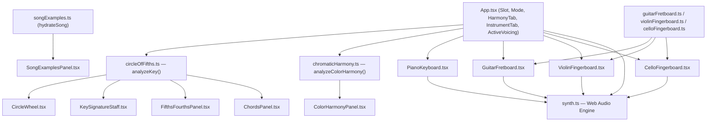

# Architecture Overview

**Musical Scales** (`musical-scales`) is an interactive music theory, chord voicing, and synthesis web application built with React 19, TypeScript, Vite, Web Audio API, and Cloudflare Workers (Hono).

---

## Tech Stack

- **Frontend**: React 19, TypeScript, custom SVG visualizers, CSS variables (dark/light themes)
- **Audio**: Native browser Web Audio API (zero external sample files)
- **Edge Runtime**: Cloudflare Workers + Hono (`src/worker/index.ts`)
- **Runtime, Package Manager & Tooling**: Bun (`bun install`, `bun test`, `bun check`, `bun fmt`, `bun lint`), Vite 8, Wrangler

---

## Directory Structure

```text
musical-scales/
├── dist/
├── docs/
│   ├── architecture.md               # Architecture documentation
│   └── images/                       # README showcase screenshots
├── public/
│   ├── _headers                      # Static asset security headers (CSP, COOP/CORP, etc.)
│   ├── favicon.svg
│   └── logo.png                      # App brand icon
├── scripts/
│   └── bun-undici-preload.cjs        # Vite/Wrangler preload helper under Bun
├── src/
│   ├── react-app/
│   │   ├── App.tsx                   # Root state container, harmony/instrument tabs, audio sequencer
│   │   ├── App.css                   # Layout, theme tokens, and SVG component styles
│   │   ├── index.css                 # Base styles & CSS custom properties
│   │   ├── main.tsx                  # React DOM entry point
│   │   ├── audio/
│   │   │   └── synth.ts              # Web Audio synthesizer (Piano, Guitar, Violin, Cello, Pad) & scheduler
│   │   ├── components/
│   │   │   ├── CircleWheel.tsx       # Interactive 12-wedge SVG Circle of Fifths wheel
│   │   │   ├── KeySignatureStaff.tsx # Treble clef SVG key signature renderer
│   │   │   ├── FifthsFourthsPanel.tsx# Counter-clockwise (4th) & clockwise (5th) comparison
│   │   │   ├── ChordsPanel.tsx       # Diatonic triads/7ths & root parallel chord cards
│   │   │   ├── ColorHarmonyPanel.tsx # Chromatic passing, dim7 symmetry, V7/x, tritone subs
│   │   │   ├── PianoKeyboard.tsx     # 2-octave (C4–B5) SVG piano visualizer
│   │   │   ├── GuitarFretboard.tsx   # 6-string, 15-fret CAGED, pentatonic & passing visualizer
│   │   │   ├── BowedFingerboard.tsx  # Shared 4-string fretless bowed fingerboard & LH frame SVG
│   │   │   ├── ViolinFingerboard.tsx # 4-string violin fingerboard (G3–D4–A4–E5)
│   │   │   ├── CelloFingerboard.tsx  # 4-string cello fingerboard (C2–G2–D3–A3)
│   │   │   ├── SongExamplesPanel.tsx # Interactive bar-by-bar song repertoire player & study guide
│   │   │   └── Icons.tsx             # Inline SVG icons shared across panels
│   │   └── theory/
│   │       ├── circleOfFifths.ts     # Note tables, scales, signatures, diatonic chords, progressions
│   │       ├── chromaticHarmony.ts   # Passing slides, symmetric dim7, secondary dominants, tritone subs
│   │       ├── guitarFretboard.ts    # Tuning, 13 chord variations, CAGED voicings, pentatonic/passing guides
│   │       ├── celloFingerboard.ts   # Bowed fifths voicing engine & Cello tuning (C2–G2–D3–A3)
│   │       ├── violinFingerboard.ts  # Violin tuning (G3–D4–A4–E5) & closed-frame voicings
│   │       ├── songExamples.ts       # CompactSongSpec hydrator, playback flattener & time lookup
│   │       ├── debussyClairDeLune.ts # Piano repertoire: Clair de lune (72 bars)
│   │       ├── schubertMomentMusicaux3.ts # Piano repertoire: Schubert Moment Musicaux No. 3 (78 bars)
│   │       ├── tommyAmazingGrace.ts  # Guitar repertoire: Amazing Grace arr. Tommy Emmanuel (34 bars)
│   │       ├── cannonballRag.ts      # Guitar repertoire: Merle Travis Cannonball Rag (75 bars)
│   │       ├── massenetMeditation.ts # Violin repertoire: Massenet Méditation from Thaïs (71 bars)
│   │       ├── bachCelloSuite1.ts    # Cello repertoire: Bach Cello Suite No. 1 Prelude (42 bars)
│   │       └── haydnCelloConcerto2.ts # Cello repertoire: Haydn Cello Concerto No. 2 Rondo (50 bars)
│   └── worker/
│       └── index.ts                  # Hono worker with CSP/COOP/CORP headers, 405 & 404 JSON
├── tests/                            # Bun test suite (theory, harmony, voicings, DSP, playback, SSR)
└── bunfig.toml                       # Bun formatter configuration
```

---

## Data Flow & Component Architecture



---

## Core Modules

### 1. Music Theory Engine (`src/react-app/theory/`)

- **[`circleOfFifths.ts`](../src/react-app/theory/circleOfFifths.ts)**:
  - Exports shared note tables (`LETTERS`, `NATURAL_PC`, `SHARP_CHROMATIC`, `FLAT_CHROMATIC`, `READABLE_CHROMATIC`) and `CIRCLE_SLOTS`, supporting enharmonic spelling at slots `5`, `6`, and `7` (`C♯/D♭`, `F♯/G♭`, `C♭/B`) and accidental preferences (`standard`, `sharps`, `flats`).
  - `buildScale()` constructs 7-note diatonic scales with one note per letter name (`A–G`), computing exact accidentals (`♭`, `♯`, `𝄪`, `𝄫`), and `ascendingNotesToMidi()` maps ordered note spellings to MIDI pitches.
  - `analyzeKey()` returns the complete `KeyAnalysis` for any slot and mode: scale notes, MIDI pitches (`C4–B5`), 7 diatonic chords (grouped into 3 major, 3 minor, and 1 diminished), harmonic minor `V(7)`, relative/parallel keys, fifth/fourth neighbor diffs (which 6 notes stay shared and which single note shifts by a semitone), and curated `ChordProgression` sets (11 Major, 10 Minor).

- **[`chromaticHarmony.ts`](../src/react-app/theory/chromaticHarmony.ts)**:
  - `analyzeColorHarmony()` derives chromatic passing-tone patterns, symmetric `dim7` chord families, secondary dominants (`V7/...`), and tritone substitutions (`♭II7`) for the active key.

- **[`guitarFretboard.ts`](../src/react-app/theory/guitarFretboard.ts)**:
  - Defines standard 6-string tuning (`E2–A2–D3–G3–B3–E4`) across 15 frets and 13 chord variations (`CHORD_VARIATION_SPECS`, `buildChordVariation()`).
  - `getGuitarVoicings()` generates open and movable CAGED/shell voicings (`<= 4` fret span) across all 15 roots and 13 chord kinds, ranked by playability.
  - `buildGuitarScalePassGuide()` derives key/chord pentatonic overlays, CAGED pockets, and playable chromatic passing phrases; `createPitchClassNameResolver()` handles enharmonic note naming across string instruments.

- **[`celloFingerboard.ts`](../src/react-app/theory/celloFingerboard.ts)** & **[`violinFingerboard.ts`](../src/react-app/theory/violinFingerboard.ts)**:
  - Share `getBowedFifthsVoicings()` across 4-string fifths-tuned instruments (`C2–G2–D3–A3` for Cello and `G3–D4–A4–E5` for Violin) over 14 semitones.
  - `getCelloVoicings()` and `getViolinVoicings()` generate playable 3- and 4-string stops across all 13 chord qualities constrained to a closed 3-semitone left-hand frame (`fingers 1–4`, `0` for open string).

- **[`songExamples.ts`](../src/react-app/theory/songExamples.ts)** (+ repertoire leaf modules):
  - Hydrates pure data specs (`CompactSongSpec` via `hydrateSong()`) from [`debussyClairDeLune.ts`](../src/react-app/theory/debussyClairDeLune.ts) (_Clair de lune_ for Piano, 72 bars), [`schubertMomentMusicaux3.ts`](../src/react-app/theory/schubertMomentMusicaux3.ts) (_Moment Musicaux No. 3_ by Franz Schubert for Piano, 78 bars), [`tommyAmazingGrace.ts`](../src/react-app/theory/tommyAmazingGrace.ts) (_Amazing Grace_ arr. Tommy Emmanuel for Guitar, 34 bars), [`cannonballRag.ts`](../src/react-app/theory/cannonballRag.ts) (_Cannonball Rag_ by Merle Travis for Guitar, 75 bars), [`massenetMeditation.ts`](../src/react-app/theory/massenetMeditation.ts) (_Méditation (from Thaïs)_ by Jules Massenet for Violin, 71 bars), [`bachCelloSuite1.ts`](../src/react-app/theory/bachCelloSuite1.ts) (_Bach Cello Suite No. 1 Prelude_ for Cello, 42 bars), and [`haydnCelloConcerto2.ts`](../src/react-app/theory/haydnCelloConcerto2.ts) (_Cello Concerto No. 2 in D Major, III. Rondo: Allegro_ by Joseph Haydn for Cello, 50 bars).
  - Flattens bar events via `flattenSongPlaybackSteps()` and supports timeline lookup/formatting via `findPlaybackEventAtTime()` and `getSongBarStartTimes()`.

---

### 2. Web Audio Synthesizer (`src/react-app/audio/synth.ts`)

- Procedural synthesis with no external audio dependencies:
  - **Piano (`piano`)**: Filtered hammer noise burst + fundamental triangle, warm sub-octave sine, and detuned harmonic sines.
  - **Acoustic Guitar (`guitar`)**: Extended Karplus-Strong physical string model (`synthesizeGuitarPluckSamples`) with pick-position comb filtering, one-pole + all-pass fractional delay tuning, and spruce/air-cavity body resonance filters.
  - **Solo Violin (`violin`) & Solo Cello (`cello`)**: Bowed sawtooth + triangle oscillators via `scheduleBowedVoice()` with vibrato LFO, bow-rosin attack transient, and instrument-specific body formant filters (`278/490/980/2450 Hz` for Violin, `78/195/490/1150 Hz` for Cello).
  - **Warm Pad (`pad`)**: Detuned dual-oscillator low-pass sustain voice.
- **Lifecycle & Safety**:
  - Validates all MIDI inputs (`0..127`) via `isValidMidi()` and guards `AudioContext` initialization in `getAudioEngine()`.
  - Tracks primary and auxiliary sources (`registerVoiceCleanup`, `registerAuxSource`), disconnecting nodes on `onended`, and drives `playTimedSequence()` via a lookahead Web Audio scheduler (`LOOKAHEAD_SEC = 0.13`, `requestAnimationFrame` + `setInterval`) with immediate cancellation via `stopAllAudio()`.

---

### 3. UI & State Management (`src/react-app/`)

- **[`App.tsx`](../src/react-app/App.tsx)**:
  - Single source of truth (`useState`) for key selection (`selectedSlot`, `mode`, `preference`, `slotOverrides`), harmony tab (`chords`, `color`), instrument dock (`piano`, `guitar`, `violin`, `cello`), seventh-chord toggle (`voicingMode`), theme (`dark`/`light`), sound mode (`auto`, `pad`, `muted`), and active chord/song state (`ActiveVoicing`, `WheelChordHighlight`).
  - Manages scheduled sequences via `cancelSequenceRef` and cancels both sequence scheduling and active Web Audio voices (`stopActiveSequence()`, `stopAllAudio()`) whenever playback stops, resets, or changes keys.
- **[`CircleWheel.tsx`](../src/react-app/components/CircleWheel.tsx)**:
  - Computes shortest-path cumulative rotation (`±180°` delta normalization) so stepping clockwise/counter-clockwise smoothly animates the selected tonic to 12 o'clock while counter-rotating text labels to remain upright.

---

### 4. Edge Worker & Security (`src/worker/index.ts`, `public/_headers`)

- **[`src/worker/index.ts`](../src/worker/index.ts)** uses Hono's `secureHeaders` middleware to attach `X-Frame-Options: DENY`, `X-Content-Type-Options: nosniff`, `Referrer-Policy: strict-origin-when-cross-origin`, `Cross-Origin-Opener-Policy: same-origin`, `Cross-Origin-Resource-Policy: same-origin`, `Permissions-Policy`, and strict API `Content-Security-Policy` (`default-src 'none'`, `base-uri 'none'`, `form-action 'none'`, `frame-ancestors 'none'`).
- All `/api/*` and unknown routes return `Cache-Control: no-store` with JSON `405` (non-`GET`/`HEAD` on `/api/*`) or `404` responses.
- **[`public/_headers`](../public/_headers)** applies matching `COOP`/`CORP`, framing, and app `Content-Security-Policy` headers to static client assets served by Cloudflare.

---

### 5. Verification & Testing (`tests/`)

Run via `bun test`:

- **[`circleOfFifths.test.ts`](../tests/circleOfFifths.test.ts)**: Verifies enharmonic scale spelling, diatonic chord qualities, `6/7` shared-note neighbor invariants, progression validity, and MIDI range bounds (`C4..B5`).
- **[`chromaticHarmony.test.ts`](../tests/chromaticHarmony.test.ts)**: Validates chromatic passing slides, symmetric `dim7` families, secondary dominants, and tritone substitutions across all 12 Circle slots in Major and Minor modes.
- **[`guitarFretboard.test.ts`](../tests/guitarFretboard.test.ts)** & **[`celloFingerboard.test.ts`](../tests/celloFingerboard.test.ts)**: Exhaustively validate that all 15 roots × 13 chord qualities produce at least 3 playable voicings within hand-span limits, plus guitar pentatonic/passing guides.
- **[`synth.test.ts`](../tests/synth.test.ts)**: Verifies `A4 = 440 Hz` tuning, autocorrelation pitch accuracy and decay envelope of the Karplus-Strong guitar model across `E2–E5`, and safe handling of invalid MIDI inputs.
- **[`songExamples.test.ts`](../tests/songExamples.test.ts)**, **[`songPlayback.test.tsx`](../tests/songPlayback.test.tsx)** & **[`appRender.test.tsx`](../tests/appRender.test.tsx)**: Verify curated repertoire bar timelines, guitar/cello physical stops, transport scrubber controls, lookahead playback timing, and SSR component rendering.
