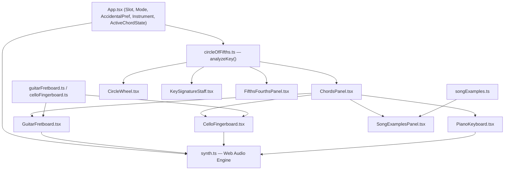

# Architecture Overview

**Circle of Fifths Studio** (`musical-scales`) is an interactive music theory, chord voicing, and synthesis web application built with React 19, TypeScript, Vite, Web Audio API, and Cloudflare Workers (Hono).

---

## Tech Stack

- **Frontend**: React 19, TypeScript, custom SVG visualizers, CSS variables (dark/light themes)
- **Audio**: Native browser Web Audio API (zero external sample files)
- **Edge Runtime**: Cloudflare Workers + Hono (`src/worker/index.ts`)
- **Build & Tooling**: Vite 7, Wrangler, ESLint 9, Bun (`bun test`)

---

## Directory Structure

```text
musical-scales/
├── docs/
│   └── architecture.md              # Architecture documentation
├── public/
│   ├── _headers                     # Static asset security headers (CSP, X-Frame-Options, etc.)
│   └── logo.png                     # App brand icon
├── src/
│   ├── react-app/
│   │   ├── App.tsx                  # Root state container, URL/storage sync, audio sequencer
│   │   ├── App.css                  # Layout, theme tokens, and SVG component styles
│   │   ├── main.tsx                 # React DOM entry point
│   │   ├── audio/
│   │   │   └── synth.ts             # Web Audio synthesizer (Piano, Karplus-Strong Guitar, Cello, Pad)
│   │   ├── components/
│   │   │   ├── CircleWheel.tsx      # Interactive 12-wedge SVG Circle of Fifths wheel
│   │   │   ├── KeySignatureStaff.tsx# Treble clef SVG key signature renderer
│   │   │   ├── FifthsFourthsPanel.tsx# Counter-clockwise (IV) & clockwise (V) neighbor comparison
│   │   │   ├── ChordsPanel.tsx      # Diatonic triads/7ths, instrument tabs, progressions, and songs
│   │   │   ├── PianoKeyboard.tsx    # 2-octave (C4–B5) SVG piano visualizer
│   │   │   ├── GuitarFretboard.tsx  # 6-string, 15-fret CAGED & open chord fretboard visualizer
│   │   │   ├── CelloFingerboard.tsx # 4-string fretless cello fingerboard & hand-frame visualizer
│   │   │   └── SongExamplesPanel.tsx# Interactive bar-by-bar song repertoire player
│   │   └── theory/
│   │       ├── circleOfFifths.ts    # Scales, key signatures, diatonic chords, and neighbor diffs
│   │       ├── guitarFretboard.ts   # Guitar tuning, CAGED/open voicings, pitch-class resolver
│   │       ├── celloFingerboard.ts  # Cello tuning, closed left-hand frame voicings & fingerings
│   │       └── songExamples.ts      # Curated repertoire & playback event timeline flattener
│   └── worker/
│       └── index.ts                 # Hono API worker with security headers & 404 fallback
└── tests/                           # Bun test suite (theory, voicings, audio DSP, SSR rendering)
```

---

## Data Flow & Component Architecture



---

## Core Modules

### 1. Music Theory Engine (`src/react-app/theory/`)

- **[`circleOfFifths.ts`](../src/react-app/theory/circleOfFifths.ts)**:
  - Models the 12 Circle of Fifths positions (`CIRCLE_SLOTS`), supporting enharmonic spelling at slots `5`, `6`, and `7` (`C♯/D♭`, `F♯/G♭`, `C♭/B`) and accidental preferences (`standard`, `sharps`, `flats`).
  - `buildScale()` constructs 7-note diatonic scales with one note per letter name (`A–G`), computing exact accidentals (`♭`, `♯`, `𝄪`, `𝄫`).
  - `analyzeKey()` returns the complete `KeyAnalysis` for any slot and mode: scale notes, MIDI pitches (`C4–B5`), 7 diatonic chords (grouped into 3 major, 3 minor, and 1 diminished), harmonic minor `V(7)`, relative/parallel keys, and fifth/fourth neighbor pitch-shift diffs (which 6 notes remain invariant and which single note shifts by a semitone).

- **[`guitarFretboard.ts`](../src/react-app/theory/guitarFretboard.ts)**:
  - Defines standard 6-string tuning (`E2–A2–D3–G3–B3–E4`) across 15 frets.
  - `getGuitarVoicings()` generates ergonomic open and movable CAGED/shell voicings (`<= 4` fret span) for all 15 roots and 7 chord qualities (`major`, `minor`, `diminished`, `maj7`, `m7`, `7`, `m7♭5`), ranked by playability.
  - Exports `createPitchClassNameResolver()` for consistent enharmonic note naming across string instruments.

- **[`celloFingerboard.ts`](../src/react-app/theory/celloFingerboard.ts)**:
  - Defines standard 4-string cello tuning in fifths (`C2–G2–D3–A3`) across 14 semitones (First through Fourth/Thumb position).
  - `getCelloVoicings()` generates playable 3- and 4-string double/triple/quadruple stops constrained to a closed 3-semitone left-hand frame (`fingers 1–4`, `0` for open string).

- **[`songExamples.ts`](../src/react-app/theory/songExamples.ts)**:
  - Stores instrument-specific repertoire (*Do-Re-Mi* for Piano, *Amazing Grace* for Guitar, *Bach Cello Suite No. 1 Prelude* for Cello) and flattens bar steps into timestamped playback schedules via `flattenSongPlaybackSteps()`.

---

### 2. Web Audio Synthesizer (`src/react-app/audio/synth.ts`)

- Procedural synthesis with no external audio dependencies:
  - **Piano (`piano`)**: Filtered hammer noise burst + fundamental triangle, warm sub-octave sine, and detuned harmonic sines.
  - **Acoustic Guitar (`guitar`)**: Extended Karplus-Strong physical string model (`synthesizeGuitarPluckSamples`) with pick-position comb filtering, one-pole + all-pass fractional delay tuning, and spruce/air-cavity body resonance filters.
  - **Solo Cello (`cello`)**: Bowed sawtooth + triangle oscillators with 5.4 Hz vibrato LFO, bow-rosin attack transient, and 3-band wooden body formant filters (230 Hz, 520 Hz, 2150 Hz).
  - **Warm Pad (`pad`)**: Detuned dual-oscillator low-pass sustain voice.
- **Lifecycle & Safety**:
  - Validates all MIDI inputs (`0..127`) via `isValidMidi()`.
  - Tracks active oscillator and buffer sources in `activeVoiceSources`, disconnecting per-note audio subgraphs on `onended` (`registerVoiceCleanup`) and supporting immediate cancellation via `stopAllAudio()`.

---

### 3. UI & State Management (`src/react-app/`)

- **[`App.tsx`](../src/react-app/App.tsx)**:
  - Single source of truth for key selection (`slot`, `mode`, `accidentalPref`), instrument tab (`piano`, `guitar`, `cello`), seventh-chord toggle (`showSevenths`), and active chord/song playback (`ActiveChordState`).
  - Synchronizes key and mode with URL query parameters (`?slot=&mode=`) and persists user preferences (`theme`, `sound`, `instrument`, `sevenths`) to `localStorage`.
  - Manages scheduled audio/visual timers (`timersRef`) and cancels both pending timers and active Web Audio voices (`stopAllAudio()`) whenever playback stops or the user changes keys.
- **[`CircleWheel.tsx`](../src/react-app/components/CircleWheel.tsx)**:
  - Computes shortest-path cumulative rotation (`±180°` delta normalization) so stepping clockwise/counter-clockwise smoothly animates the selected tonic to 12 o'clock while counter-rotating text labels to remain upright.

---

### 4. Edge Worker & Security (`src/worker/index.ts`, `public/_headers`)

- **[`src/worker/index.ts`](../src/worker/index.ts)** uses Hono's `secureHeaders` middleware to attach strict response headers (`Content-Security-Policy`, `X-Frame-Options: DENY`, `X-Content-Type-Options: nosniff`, `Referrer-Policy: strict-origin-when-cross-origin`, `Permissions-Policy`) and returns structured JSON `404` responses for unknown `/api/*` routes.
- **[`public/_headers`](../public/_headers)** applies matching security headers to static client assets served by Cloudflare.

---

### 5. Verification & Testing (`tests/`)

Run via `bun test`:
- **[`circleOfFifths.test.ts`](../tests/circleOfFifths.test.ts)**: Verifies enharmonic scale spelling, diatonic chord qualities, `6/7` shared-note neighbor invariants, and MIDI range bounds (`C4..B5`).
- **[`guitarFretboard.test.ts`](../tests/guitarFretboard.test.ts)** & **[`celloFingerboard.test.ts`](../tests/celloFingerboard.test.ts)**: Exhaustively validate that all 15 roots × 7 chord qualities produce at least 3 ergonomic, harmonically complete voicings within hand-span limits.
- **[`synth.test.ts`](../tests/synth.test.ts)**: Verifies `A4 = 440 Hz` tuning, autocorrelation pitch accuracy and decay envelope of the Karplus-Strong guitar model across `E2–E5`, and safe handling of invalid MIDI inputs.
- **[`songExamples.test.ts`](../tests/songExamples.test.ts)** & **[`appRender.test.tsx`](../tests/appRender.test.tsx)**: Verify instrument-exclusive song mappings, monotonic playback timelines, and server-side rendering across keys and instruments.
