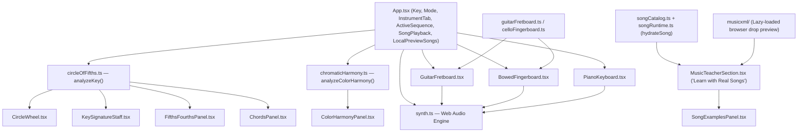

# Architecture & MusicXML Ingestion Overview

**Musical Scales** (`musical-scales`) is an interactive music theory, chord voicing, synthesis, and MusicXML repertoire studio built with React 19, TypeScript, Bun, Web Audio API, and Cloudflare Workers (Hono).

---

## Tech Stack

- **Frontend**: React 19, TypeScript, custom SVG visualizers, CSS variables (dark/light themes)
- **Audio**: Native browser Web Audio API (zero external sample files)
- **Score Standard**: Zero-dependency isomorphic MusicXML (`.musicxml`, `.xml`, `.mxl`) parser & compiler
- **Edge Runtime**: Cloudflare Workers + Hono (`src/worker/index.ts`)
- **Runtime, Package Manager, Bundler & Tooling**: Bun (`bun install`, `bun dev`, `bun build`, `bun test`, `bun check`, `bun fmt`, `bun lint`), Wrangler

---

## Directory Structure

```text
musical-scales/
├── dist/
├── docs/
│   ├── architecture.md               # System architecture & MusicXML ingestion guide
│   └── images/                       # README showcase screenshots
├── public/
│   ├── _headers                      # Static asset security headers (CSP, COOP/CORP, etc.)
│   ├── favicon.svg
│   └── logo.png                      # App brand icon
├── songs/
│   ├── annotations.json              # Curated multi-section Study Guides & landmark bar theory notes
│   ├── overrides.json                # Centralized curated title/composer/instrument/category/key overrides
│   └── musicxml/                     # Mirrored & local .musicxml / .xml / .mxl scores (+ optional .meta.json)
├── scripts/
│   ├── dev.ts                        # Initial song sync + --watch + Bun --hot dev server
│   ├── ingest-songs.ts               # Mirror, incremental compiler, --watch, single-file CLI & WAV preview
│   └── preview.ts                    # Local Bun.serve production preview (dist/client + Worker /api/*)
├── src/
│   ├── react-app/
│   │   ├── App.tsx                   # Root state container, instrument dock, Chords & Music Teacher sections
│   │   ├── App.css                   # Layout, theme tokens, and SVG component styles
│   │   ├── index.css                 # Base styles & CSS custom properties
│   │   ├── main.tsx                  # React DOM entry point
│   │   ├── assets.d.ts               # Ambient module declarations for CSS and PNG imports
│   │   ├── audio/
│   │   │   └── synth.ts              # Web Audio synthesizer (Piano, Guitar, Violin, Cello, Pad) & scheduler
│   │   ├── components/
│   │   │   ├── CircleWheel.tsx       # Interactive 12-wedge SVG Circle of Fifths wheel
│   │   │   ├── KeySignatureStaff.tsx # Treble clef SVG key signature renderer
│   │   │   ├── FifthsFourthsPanel.tsx# Counter-clockwise (4th) & clockwise (5th) comparison
│   │   │   ├── ChordsPanel.tsx       # Diatonic triads/7ths & root parallel chord cards
│   │   │   ├── ColorHarmonyPanel.tsx # Chromatic passing, dim7 symmetry, V7/x, tritone subs
│   │   │   ├── PianoKeyboard.tsx     # 2-octave (C4–B5) SVG piano visualizer
│   │   │   ├── GuitarFretboard.tsx   # 6-string, 15-fret CAGED, pentatonic & passing visualizer
│   │   │   ├── BowedFingerboard.tsx  # Shared 4-string fretless bowed fingerboard (Violin & Cello)
│   │   │   ├── MusicTeacherSection.tsx # Collapsible "Music Teacher" card ("Learn with Real Songs" + upload)
│   │   │   ├── SongExamplesPanel.tsx # Bar-by-bar player, collapsible Bar Theory Coach, study guides & empty state
│   │   │   ├── SectionHeader.tsx     # Shared collapsible card header
│   │   │   └── Icons.tsx             # Inline SVG icons, SegmentedControl, SequencePlayButton, SongHitMarker
│   │   ├── musicxml/                 # Lazy-loaded isomorphic MusicXML engine (browser + Bun CLI)
│   │   │   ├── index.ts              # Public exports: parseMusicXmlDocument(), inspectMusicXml(), compileMusicXml()
│   │   │   ├── xmlParser.ts          # Dependency-free XML parser (BOM, DOCTYPE, CDATA, entities, root/node limits)
│   │   │   ├── mxlUnpack.ts          # Compressed .mxl ZIP reader (Web Streams DecompressionStream)
│   │   │   ├── musicXmlToIr.ts       # score-partwise / score-timewise -> ScoreTrackIR adapter
│   │   │   ├── ergonomicSolver.ts    # Viterbi DP hand-position solver for guitar & bowed strings
│   │   │   ├── harmonicAnalyzer.ts   # Krumhansl-Schmuckler key detector & Roman numeral analysis
│   │   │   └── scoreCompiler.ts      # Repeat linearizer, tempo map & SongDocument compiler
│   │   ├── songs/
│   │   │   ├── songRuntime.ts        # SongDocument hydrator, speed clamping/scaler & playback flattener
│   │   │   ├── songCatalog.ts        # Repertoire metadata lookup & lazy chunk loader
│   │   │   ├── songCatalog.generated.ts # Auto-generated catalog & dynamic import() switch
│   │   │   └── generated/            # Auto-generated SongDocument TS chunks from songs/musicxml/
│   │   └── theory/
│   │       ├── circleOfFifths.ts     # Note tables, scales, signatures, diatonic chords, progressions
│   │       ├── chromaticHarmony.ts   # Passing slides, symmetric dim7, secondary dominants, tritone subs
│   │       ├── barTheoryAnalyzer.ts  # Contextual bar-by-bar theory insights, voice leading & cadence analyzer
│   │       ├── guitarFretboard.ts    # Tuning, 13 chord variations, CAGED voicings, pentatonic/passing guides
│   │       └── celloFingerboard.ts   # Bowed fifths voicing engine, Cello & Violin tunings
│   └── worker/
│       └── index.ts                  # Hono worker with CSP/COOP/CORP headers, 405 & 404 JSON
├── tests/                            # Bun test suite (theory, harmony, voicings, MusicXML, DSP, UI)
└── bunfig.toml                       # Bun formatter configuration
```

---

## Data Flow & Component Architecture



---

## Core Modules

### 1. Music Theory Engine (`src/react-app/theory/`)

- **[`circleOfFifths.ts`](../src/react-app/theory/circleOfFifths.ts)**:
  - Exports shared note tables (`LETTERS`, `NATURAL_PC`, `SHARP_CHROMATIC`, `FLAT_CHROMATIC`, `READABLE_CHROMATIC`) and `CIRCLE_SLOTS`, supporting enharmonic spelling at slots `5`, `6`, and `7` (`C♯/D♭`, `F♯/G♭`, `C♭/B`) and accidental preferences (`standard`, `sharps`, `flats`).
  - `buildScale()` constructs 7-note diatonic scales with one note per letter name (`A–G`), computing exact accidentals (`♭`, `♯`, `𝄪`, `𝄫`), and `ascendingNotesToMidi()` maps ordered note spellings to MIDI pitches.
  - `analyzeKey()` returns the complete `KeyAnalysis` for any slot and mode: scale notes, MIDI pitches (`C4–B5`), 7 diatonic chords (grouped into 3 major, 3 minor, and 1 diminished), harmonic minor `V(7)`, relative/parallel keys, fifth/fourth neighbor diffs (which 6 notes stay shared and which single note shifts by a semitone), and curated `ChordProgression` sets (11 Major, 10 Minor).
- **[`chromaticHarmony.ts`](../src/react-app/theory/chromaticHarmony.ts)**:
  - `analyzeColorHarmony()` derives chromatic passing-tone patterns, symmetric `dim7` chord families, secondary dominants (`V7/...`), and tritone substitutions (`♭II7`) for the active key.
- **[`barTheoryAnalyzer.ts`](../src/react-app/theory/barTheoryAnalyzer.ts)**:
  - `analyzeSongBarTheory()` analyzes every linearized playback bar against its neighboring bars (`Prev → Current → Next`), producing plain-English slash-bass/inversion explanations, secondary-dominant & tritone-resolution mechanics, pedal/chromatic bass lines, intra-bar progressions, and three teaching lenses (_What it's doing_, _Bigger picture_, _Why it works_) merged with optional curated `songs/annotations.json` highlights.
- **[`guitarFretboard.ts`](../src/react-app/theory/guitarFretboard.ts)**:
  - Defines standard 6-string tuning (`E2–A2–D3–G3–B3–E4`) across 15 frets (`MAX_SONG_GUITAR_FRET = 22`) and 13 chord variations (`CHORD_VARIATION_SPECS`, `buildChordVariation()`).
  - `getGuitarVoicings()` generates open and movable CAGED/shell voicings (`<= 4` fret span) across all 15 roots and 13 chord kinds, ranked by playability.
  - `buildGuitarScalePassGuide()` derives key/chord pentatonic overlays, CAGED pockets, and playable chromatic passing phrases; `createPitchClassNameResolver()` handles enharmonic note naming across string instruments.
- **[`celloFingerboard.ts`](../src/react-app/theory/celloFingerboard.ts)**:
  - Shares `getBowedFifthsVoicings()` and `getBowedVoicings()` across 4-string fifths-tuned instruments (`CELLO_TUNING`: `C2–G2–D3–A3`, `VIOLIN_TUNING`: `G3–D4–A4–E5`) over `MAX_BOWED_SEMITONE = 14` (`MAX_SONG_BOWED_SEMITONE = 24`).
  - Generates playable 3- and 4-string stops across all 13 chord qualities constrained to a closed 3-semitone left-hand frame (`fingers 1–4`, `0` for open string).

### 2. Song Runtime & Catalog (`src/react-app/songs/`, `songs/`)

- **[`songRuntime.ts`](../src/react-app/songs/songRuntime.ts)**:
  - Hydrates tick-based [`SongDocument`](../src/react-app/songs/songRuntime.ts) (`version: 2`, `tpq`, `tempoMap`, normalized `chords` palette, `form` bar reuse, unified stops, piano `"rh" | "lh"` hand tags) via `hydrateSong()`, and supports practice speed scaling (`0.5x–2x`) via `scaleSongExampleSpeed()`.
  - Flattens bar events via `flattenSongPlaybackSteps()` and supports timeline lookup/formatting via `findPlaybackEventAtTime()` and `getSongBarStartTimes()`.
- **[`songCatalog.ts`](../src/react-app/songs/songCatalog.ts)** & **[`songCatalog.generated.ts`](../src/react-app/songs/songCatalog.generated.ts)**:
  - Exposes repertoire metadata generated from `songs/musicxml/` and dynamically loads individual [`SongDocument`](../src/react-app/songs/songRuntime.ts) modules from `src/react-app/songs/generated/` on demand so each piece is code-split out of the initial client bundle.

---

## MusicXML Ingestion Pipeline (`src/react-app/musicxml/`, `scripts/ingest-songs.ts`)

**MusicXML (`.musicxml`, `.xml`, `.mxl`)** is the single ingestion standard for `musical-scales`. An external Python pipeline (parsing video, audio, or sheet music into MusicXML) only needs to emit valid MusicXML scores; all downstream normalization, fingering calculation, harmonic analysis, and UI rendering happen inside the zero-dependency TypeScript engine in [`src/react-app/musicxml/`](../src/react-app/musicxml/).

```text
External Python Pipeline (Video / Audio / Sheet Music)
  └──▶ MusicXML (.musicxml / .xml / .mxl)
         ├──▶ Offline CLI (`bun run ingest-songs` / `--watch`)
         │      ├── Optionally mirrors `*.musicxml` from `SONGS_SOURCE_DIR` (tracked via `.mirror-manifest.json`)
         │      ├── Scans `songs/musicxml/` (+ `songs/annotations.json`, `songs/overrides.json` & `.meta.json` sidecars)
         │      ├── Incrementally compiles `src/react-app/songs/generated/<id>.ts`
         │      └── Regenerates `src/react-app/songs/songCatalog.generated.ts`
         │
         └──▶ In-Browser Upload / Drop (Music Teacher -> Learn with Real Songs)
                ├── Lazy-loads `src/react-app/musicxml/` (~14 KB gzipped on demand)
                └── Single-pass `compileMusicXml()` hydrates local preview song into player + dock
```

### Supported MusicXML Specification (Contract for Python Producers)

| Layer                  | MusicXML Elements Read                                                                                                                                                                                          | Fallback When Omitted                                                                                           |
| :--------------------- | :-------------------------------------------------------------------------------------------------------------------------------------------------------------------------------------------------------------- | :-------------------------------------------------------------------------------------------------------------- |
| **Container**          | Uncompressed `.musicxml`/`.xml` (`score-partwise` or `score-timewise`) and compressed `.mxl` (`META-INF/container.xml`)                                                                                         | Filename used for song slug/title if `<work-title>` / `<movement-title>` is absent                              |
| **Part & Instrument**  | `<score-part>`, `<part-name>`, `<instrument-sound>`, `<midi-program>` (1-based GM), `<staves>`, `<staff-tuning>`, `<capo>`                                                                                      | Inferred from clef, staff count (`>= 2` staves → Piano), pitch range, or `--instrument`                         |
| **Timing & Meter**     | `<divisions>`, `<time><beats>/<beat-type>`, `<note><duration>`, `<backup>`, `<forward>`, `<chord/>`, `<rest/>`, `<grace/>`, `<tie>`/`<tied>`, `<measure implicit="yes">`, `<sound tempo="..."/>`, `<metronome>` | Normalized to `tpq = 960`; defaults to `4/4` and `120 BPM`                                                      |
| **Transposition**      | `<attributes><transpose><chromatic>` and `<octave-change>`                                                                                                                                                      | Concert pitch assumed when `<transpose>` is absent                                                              |
| **Key & Harmony**      | `<key><fifths>/<mode>` and `<harmony>` (`<root>`, `<kind>`, `<bass>` slash chords, `<offset>`)                                                                                                                  | Krumhansl-Schmuckler key detection + weighted bar/half-bar chord & Roman numeral inference                      |
| **Piano Details**      | `<staves>2</staves>` (`staff 1` → `"rh"`, `staff 2` → `"lh"`) and `<pedal type="start\|change\|stop"/>`                                                                                                         | Single-staff notes omit hand tags; natural note durations used                                                  |
| **Stringed Details**   | `<staff-tuning line="1..N">`, `<capo>`, `<technical><string>` (`1` = highest string), `<fret>`, `<fingering>`, `<open-string/>`                                                                                 | Viterbi DP solver computes minimum-shift guitar frets (`0..22`) or violin/cello stops (`0..24`, fingers `0..4`) |
| **Articulations**      | `<harmonic>`, `<hammer-on>`, `<pull-off>`, `<slide>`/`<glissando>`, `<staccato>`, `<slur>`, `<words>` (`pizz.`, `arco`, `P.M.`, `let ring`), `<dynamics>`                                                       | Standard `"normal"` articulation and `0.78` velocity                                                            |
| **Form & Study Guide** | `<barline><repeat>`, `<ending>` (voltas), `<rehearsal>` section markers                                                                                                                                         | Repeats linearized & deduplicated into `form[]`; section guide auto-grouped                                     |

### Ingestion Modules (`src/react-app/musicxml/`)

- **[`xmlParser.ts`](../src/react-app/musicxml/xmlParser.ts)**: Bounded (`MAX_XML_DEPTH = 64`, `MAX_XML_CHARS = 16 MB`, `MAX_XML_NODES = 250_000`), single-root dependency-free XML parser supporting UTF-8/UTF-16 BOMs, `<!DOCTYPE>` internal subsets, comments, `CDATA`, null-prototype attribute maps, and valid Unicode code-point checks on numeric/named entities.
- **[`mxlUnpack.ts`](../src/react-app/musicxml/mxlUnpack.ts)**: Reads `.mxl` ZIP central directory headers with entry-count (`128`), EOCD comment length & field-bounds checks, entry-path safety (`..`, leading `/` or `\`, and Windows drive-letter rejection), and streaming `DecompressionStream("deflate-raw")` size caps (`16 MB`), extracting only `META-INF/container.xml` and the target root score.
- **[`musicXmlToIr.ts`](../src/react-app/musicxml/musicXmlToIr.ts)**: Converts `score-partwise` (and `score-timewise`, preserving null-prototype attrs) parts into canonical `ScoreTrackIR`, providing `parseMusicXmlDocument()`, `inspectMusicXml()`, and single-pass `compileMusicXml()` with `preferredInstrument` auto-selection.
- **[`ergonomicSolver.ts`](../src/react-app/musicxml/ergonomicSolver.ts)**: Uses Viterbi dynamic programming across playable left-hand fret/semitone positions (`MAX_SONG_GUITAR_FRET = 22`, `MAX_SONG_BOWED_SEMITONE = 24`) to minimize position jumps and string crossings when a stringed MusicXML part omits explicit `<technical>` stops.
- **[`harmonicAnalyzer.ts`](../src/react-app/musicxml/harmonicAnalyzer.ts)**: Detects tonal center via Krumhansl-Schmuckler pitch-class correlation and infers or resolves bar/sub-bar Roman numerals and slash/extended chord symbols.
- **[`scoreCompiler.ts`](../src/react-app/musicxml/scoreCompiler.ts)**: Linearizes repeats & voltas (`MAX_LINEARIZED_BARS = 4096`), aligns bar-local tempo changes, deduplicates identical bars into `form`, reuses a precomputed `KeyAnalysis` per score, and compiles normalized tick-based [`SongDocument`](../src/react-app/songs/songRuntime.ts) modules.

### CLI Ingestion Workflow (`scripts/ingest-songs.ts`)

1. Drop `.musicxml`, `.xml`, or `.mxl` files into `songs/musicxml/` (optionally alongside a `<name>.meta.json` sidecar with `{ id, title, composerOrSource, subtitle, instrument, category, partId, partIndex, quantizeSubdivision, splitHalfBarHarmony, studyGuide }`) and run (`slugifyId`, sidecar schema/instrument validation, and filesystem containment enforce valid inputs and keep writes within `songs/musicxml/` and `src/react-app/songs/generated/`):

   ```bash
   bun run ingest-songs
   ```

2. Or inspect parts, copy a file into `songs/musicxml/`, and render a 22.05 kHz WAV verification check in one step:

   ```bash
   bun run ingest-songs --input path/to/score.mxl --list-parts
   bun run ingest-songs --input path/to/score.mxl --instrument guitar --copy --wav /tmp/preview.wav
   ```

---

### 3. Web Audio Synthesizer (`src/react-app/audio/synth.ts`)

- Procedural synthesis with no external audio dependencies:
  - **Piano (`piano`)**: Filtered hammer noise burst + fundamental triangle, warm sub-octave sine, and detuned harmonic sines.
  - **Acoustic Guitar (`guitar`)**: Extended Karplus-Strong physical string model (`synthesizeGuitarPluckSamples`) with pick-position comb filtering, one-pole + all-pass fractional delay tuning, spruce/air-cavity body resonance filters, and expressive performance articulations (`palmMute`, `harmonic`, `hammer`, `pull`, `slide`, `letRing`, `staccato`).
  - **Solo Violin (`violin`) & Solo Cello (`cello`)**: Bowed sawtooth + triangle oscillators via `scheduleBowedVoice()` with vibrato LFO, bow-rosin attack transient, instrument-specific body formant filters (`278/490/980/2450 Hz` for Violin, `78/195/490/1150 Hz` for Cello), and articulations (`pizzicato`, `portamento`, `harmonic`, `staccato`, `slur`).
  - **Warm Pad (`pad`)**: Detuned dual-oscillator low-pass sustain voice.
- **Offline Audio Verification**: Pure TypeScript sample renderer (`renderTimedSequenceOfflineSamples()`, `encodeWavPcm16()`) mirrors live synthesis offline (clamping sample rates to `8000..96000 Hz` and render duration to `MAX_OFFLINE_RENDER_SEC = 600`) so ingested MusicXML scores can be audited as WAV files via `--wav`.
- **Lifecycle & Safety**: Validates all MIDI inputs (`0..127`) via `isValidMidi()`, guards `AudioContext` initialization in `getAudioEngine()`, disconnects finished nodes on `onended`, and drives `playTimedSequence()` via a lookahead scheduler (`LOOKAHEAD_SEC = 0.13`, `requestAnimationFrame` + `setInterval`) with immediate cancellation via `stopAllAudio()`.

---

### 4. UI & State Management (`src/react-app/`)

- **[`App.tsx`](../src/react-app/App.tsx)**:
  - Single source of truth (`useState`) for key selection (`selectedSlot`, `mode`, `preference`, `slotOverrides`), harmony workspace tab (`chords`, `color`), instrument dock (`piano`, `guitar`, `violin`, `cello`), seventh-chord toggle (`voicingMode`), theme (`dark`/`light`), sound mode (`auto`, `pad`, `muted`), consolidated transient `activeSequence` / `songPlayback` / `openPopover` states, shared `runStepSequence` sequence orchestration, and single-pass in-browser MusicXML preview state (`10 MB` file limit, stale-request cancellation for async song playback and MusicXML imports).
  - Right column stacks:
    1. **Interactive Instruments Dock** (`#section-instruments`)
    2. **Neighbors** (`#section-neighbors`, collapsible, collapsed by default) → Adjacent 4th & 5th key comparison, cadence audition, and circle walk
    3. **Chords** (`#section-chords`, collapsible, collapsed by default) → `Chords & Progressions` and `Passing & Substitutions`
    4. **Music Teacher** (`#section-music-teacher`, collapsible, collapsed by default) → **Learn with Real Songs** subsection (`MusicTeacherSection.tsx` + `SongExamplesPanel.tsx`), keeping the instrument visualizer above and Circle of Fifths wheel beside it synced live during song playback
- **[`CircleWheel.tsx`](../src/react-app/components/CircleWheel.tsx)**:
  - Computes shortest-path cumulative rotation (`±180°` delta normalization) so stepping clockwise/counter-clockwise smoothly animates the selected tonic to 12 o'clock while counter-rotating text labels to remain upright.

---

### 5. Edge Worker & Security (`src/worker/index.ts`, `public/_headers`)

- **[`src/worker/index.ts`](../src/worker/index.ts)** uses Hono's `secureHeaders` middleware to attach `Strict-Transport-Security`, `X-Frame-Options: DENY`, `X-Content-Type-Options: nosniff`, `X-Permitted-Cross-Domain-Policies: none`, `Referrer-Policy: strict-origin-when-cross-origin`, `Cross-Origin-Opener-Policy: same-origin`, `Cross-Origin-Resource-Policy: same-origin`, `Permissions-Policy`, and strict API `Content-Security-Policy` (`default-src 'none'`, `base-uri 'none'`, `form-action 'none'`, `frame-ancestors 'none'`).
- All `/api/*` and unknown routes return `Cache-Control: no-store` with JSON `405` (with `Allow: GET, HEAD` for non-`GET`/`HEAD` on `/api/*`) or `404` responses.
- **[`public/_headers`](../public/_headers)** applies matching `HSTS`, `COOP`/`CORP`, framing, `X-Permitted-Cross-Domain-Policies`, and hardened app `Content-Security-Policy` headers (`img-src 'self'`, `base-uri 'none'`) to static client assets served by Cloudflare.
- **Parser & Tooling Safety**: Browser MusicXML uploads are capped at `10 MB`, `.mxl`/XML/repeat/offline-render bounds enforce entry/depth/node/bar/duration caps and null-prototype attribute/table lookups (`Object.hasOwn`), generated TS export identifiers are regex-validated, `.meta.json` sidecars are validated, and CLI file outputs check path containment.

---

### 6. Verification & Testing (`tests/`)

Run via `bun test`:

- **[`circleOfFifths.test.ts`](../tests/circleOfFifths.test.ts)**: Verifies enharmonic scale spelling, diatonic chord qualities, `6/7` shared-note neighbor invariants, progression validity, and MIDI range bounds (`C4..B5`).
- **[`chromaticHarmony.test.ts`](../tests/chromaticHarmony.test.ts)**: Validates chromatic passing slides, symmetric `dim7` families, secondary dominants, and tritone substitutions across all 12 Circle slots in Major and Minor modes.
- **[`guitarFretboard.test.ts`](../tests/guitarFretboard.test.ts)** & **[`celloFingerboard.test.ts`](../tests/celloFingerboard.test.ts)**: Exhaustively validate that all 15 roots × 13 chord qualities produce at least 3 playable voicings within hand-span limits (guitar, cello, and violin), plus guitar pentatonic/passing guides.
- **[`synth.test.ts`](../tests/synth.test.ts)**: Verifies `A4 = 440 Hz` tuning, autocorrelation pitch accuracy and decay envelope of the Karplus-Strong guitar model across `E2–E5`, safe handling of invalid MIDI inputs, and offline renderer duration/sample-rate clamping.
- **[`musicXmlPipeline.test.ts`](../tests/musicXmlPipeline.test.ts)**: Tests pure-TS XML parsing (null-prototype attrs, numeric entity bounds, multi-root & `250k`-node cap rejection), compressed `.mxl` roundtrips and path-escape/EOCD rejection, `score-partwise` & `score-timewise`, transposition, pickups, repeats/voltas, grand-staff piano & pedal extension, Drop-D guitar TAB, Viterbi non-TAB cello stops, key/harmony analysis, and offline WAV synthesis.
- **[`songPlayback.test.tsx`](../tests/songPlayback.test.tsx)** & **[`appRender.test.tsx`](../tests/appRender.test.tsx)**: Verify `SongDocument` hydration (including polyphonic custom tunings, capo, harmonic stops, and mixed-stop onset alignment), transport scrubber & empty-state UI, lookahead playback timing, live visualizer halos, `Music Teacher -> Learn with Real Songs` section layout, and Hono Worker security headers / `404` / `405` routing.
